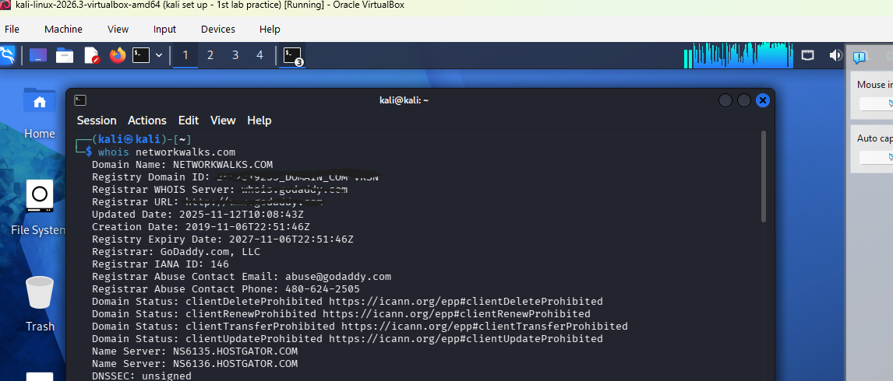
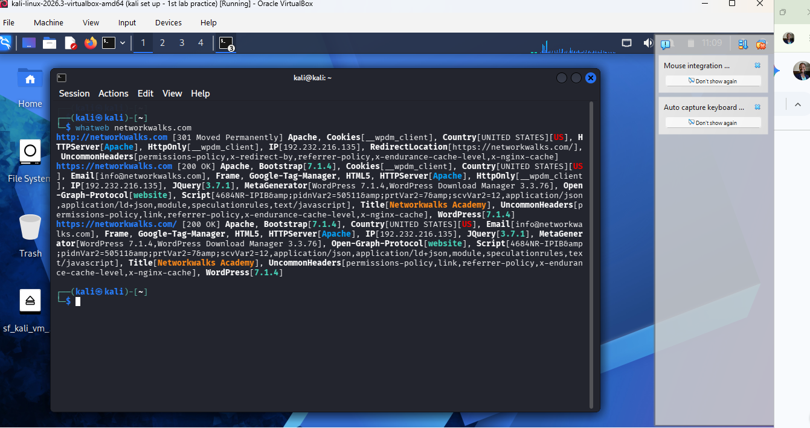
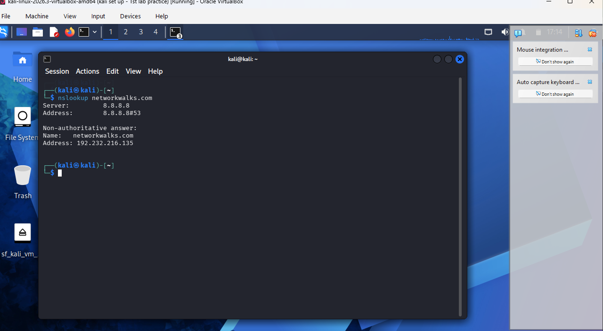
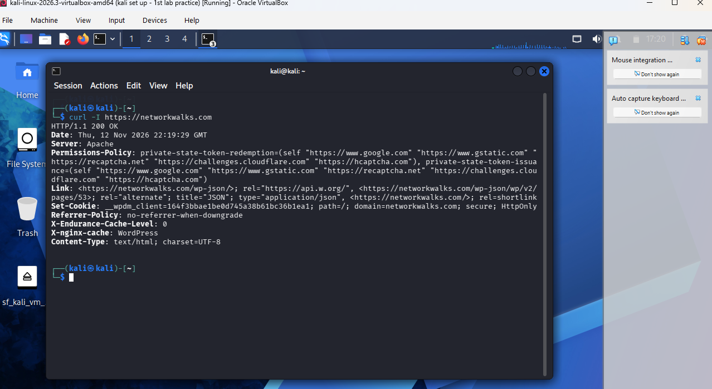
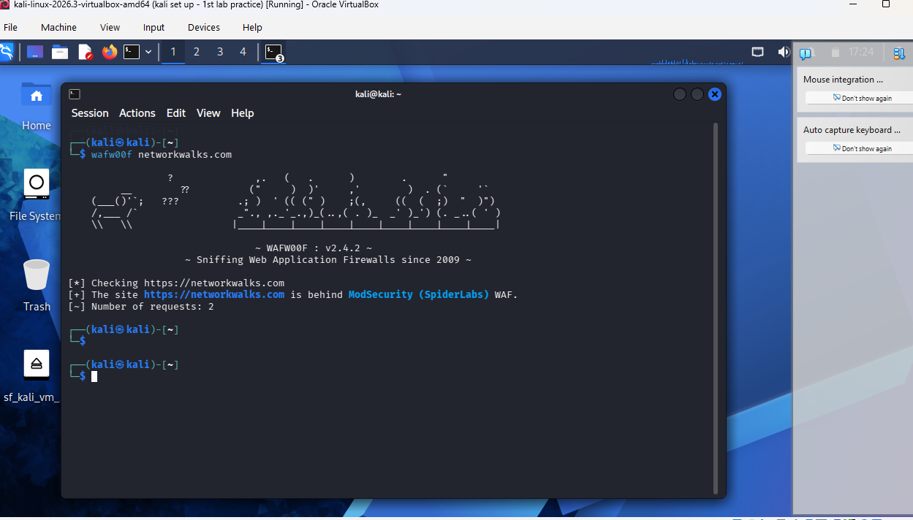
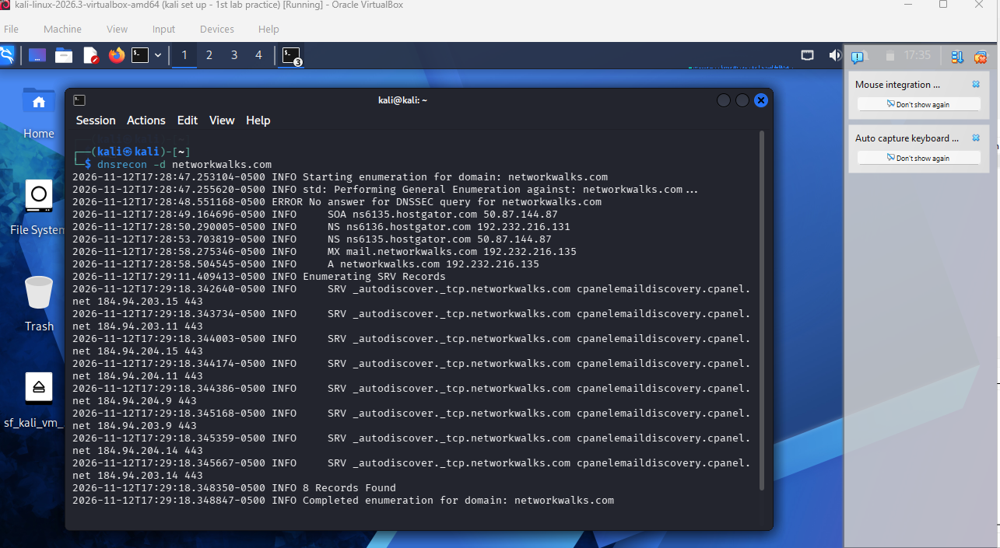

# Footprinting-Reconnaissance-and-Network-Scanning
Cybersecurity report covering practical exercises in footprinting and network scanning using Kali Linux tools, theHarvester, and Zenmap. It documents the tools and steps used while keeping actual scan results and sensitive technical details private.

| **Report Details** | **Information** |
|---|---|
| **Name** | Prudence Selasi Dela-Boso |
| **Programme / Batch** | B084 – Networkwalks |
| **Date** | 14 November 2026 |
| **Modules Completed** | W2-PM1 – Multiple Kali Linux Tools; W2-PM4 – theHarvester; W2-PM5 – Zenmap Scanning |
| **Targets** | `networkwalks.com`, `microsoft.com` and my own local network |
| **Permission** | Written permission obtained for the authorised target; local network scanning carried out on my own network |
| **Phases Covered** | Phase 1: Reconnaissance and Footprinting; Phase 2: Scanning and Network Discovery |
| **Other Phases** | Phases 3–5: In Progress |

---

# 1. Ethical Use and Legal Disclaimer

All activities in this report were carried out on systems and devices that I own or for which I had permission to perform the exercises.

This report is for learning, research and cybersecurity training purposes. The tools and techniques discussed here should not be used to access, scan or collect information from systems without proper authorisation.

Unauthorised access to computer systems and networks can have serious legal consequences, even when no damage is caused. Anyone carrying out cybersecurity testing is responsible for ensuring that their activities follow the law and remain within the approved scope.

**Always get permission before testing a system or network. Use these skills responsibly and ethically.**

# 2. Introduction

During Week 2 of my Cybersecurity and Ethical Hacking internship at Networkwalks, I completed three practical exercises covering footprinting, information gathering and network scanning.

The exercises were:

1. **W2-PM1 – Footprinting with Kali Linux tools:** I used six tools to collect publicly available information about `networkwalks.com`. These included domain registration details, website technologies, DNS information, HTTP response headers and details about the website's Web Application Firewall (WAF).

2. **W2-PM4 – Information gathering with theHarvester:** I used theHarvester to search for publicly available information linked to `microsoft.com`, focusing on email addresses and subdomains. The exercise involved searching with Baidu and using all available sources.

3. **W2-PM5 – Network scanning with Zenmap:** I scanned my own local network to identify active devices, check their IP and MAC addresses, and create a network topology showing the discovered devices.

Together, these exercises helped me understand how information can be collected about a domain and how devices connected to a local network can be discovered.

The activities were carried out using Kali Linux and a Windows computer with Zenmap installed. I have included the tools, commands, observations and supporting evidence for each exercise. I have also explained what the findings could mean from a security point of view.

# 3. Tools and Technologies Used

The following tools were used during the practical exercises.

| **Tool** | **Purpose** | **Module** |
|---|---|---|
| Kali Linux | Operating system used for the footprinting and information-gathering exercises | W2-PM1 / W2-PM4 |
| WHOIS | Retrieves publicly available domain registration information, including registration dates and name servers | W2-PM1 |
| WhatWeb | Identifies technologies used by a website, such as its CMS and plugins | W2-PM1 |
| Nslookup | Finds the IP address associated with a domain name through DNS | W2-PM1 |
| cURL (`-I`) | Retrieves HTTP response headers from a website | W2-PM1 |
| Wafw00f | Checks whether a website is protected by a Web Application Firewall | W2-PM1 |
| DNSRecon | Collects information about DNS records, including name servers and mail servers | W2-PM1 |
| theHarvester | Collects publicly available information such as email addresses and subdomains from selected sources | W2-PM4 |
| Zenmap | Provides a graphical interface for running Nmap scans and viewing discovered network devices | W2-PM5 |
| Windows Command Prompt | Used to check local network settings and IP configuration | W2-PM5 |

# 4. Practical Activities and Findings

## 4.1 W2-PM1 – Footprinting and Reconnaissance with Kali Linux

### Objective

The aim of this exercise was to gather publicly available information about `networkwalks.com` using six Kali Linux tools.

I used each tool to look at a different part of the domain and website. This helped me understand what information could be discovered without logging into the website or accessing its private systems.

### 4.1.1 WHOIS – Checking Domain Registration Information

I started with WHOIS to find publicly available information about the domain registration.

The lookup provided information about the domain, including its registration details and associated name servers. This gave me an initial idea of how the domain was registered and some of the infrastructure connected to it.

**Why this matters:**

Domain registration details can help someone understand who manages a domain and identify related infrastructure. This information may be useful during the early stages of a security assessment.

### 4.1.2 WhatWeb – Identifying Website Technologies

Next, I used WhatWeb to check the technologies running on `networkwalks.com`.

The results identified the following:

| **Technology** | **Version Identified** |
|---|---|
| WordPress | 7.1.4 |
| WP Download Manager | 3.3.76 |

The scan also returned other technical details about the website.

**Why this matters:**

Knowing which technologies a website uses can help a security professional identify software that may need further review. If an old or vulnerable version is exposed, it may give an attacker useful information when looking for possible weaknesses.

However, identifying a technology or version does not automatically mean that it is vulnerable.


### 4.1.3 Nslookup – Finding the Website's IP Address

I used Nslookup to find the IP address connected to `networkwalks.com`.

The command successfully resolved the domain to:

| **Domain** | **Resolved IP Address** |
|---|---|
| `networkwalks.com` | `192.232.216.135` |

**Why this matters:**

A domain name is easier for people to remember, while computers use IP addresses to communicate across networks. Finding the IP address helps identify the server associated with a website and can be useful during further network investigation.

### 4.1.4 cURL – Checking HTTP Response Headers

I used cURL with the `-I` option to retrieve the HTTP response headers from the website.

The response provided technical information about how the web server handled the request. 

**Why this matters:**

HTTP response headers can reveal information about a website's server and application. This information may help someone understand the technologies behind the website and decide what areas require further security checks.

The presence of the WordPress REST API endpoint is not, on its own, evidence of a security weakness.

### 4.1.5 Wafw00f – Checking for a Web Application Firewall

I then used Wafw00f to check whether a Web Application Firewall was detected on the website.

The result identified:

**ModSecurity (SpiderLabs)**

A Web Application Firewall, or WAF, helps protect web applications by monitoring and filtering certain types of incoming web traffic.

**Why this matters:**

Identifying the WAF gives an idea of the security technology used to protect a website. It can also help during an authorised assessment when reviewing how the website's protection is configured.

The detection of a WAF does not automatically confirm how effective its protection is.


### 4.1.6 DNSRecon – Gathering DNS Information

Finally, I used DNSRecon to collect more information about the domain's DNS setup.

The results provided information about:

- Name server (NS) records
- Mail server (MX) records
- SPF and TXT records
- Service (SRV) records
- DNS-related software information

**Why this matters:**

DNS records help show how a domain's services are organised. Information about mail servers, name servers and other records can help someone build a clearer picture of the organisation's online infrastructure.

---

## 4.2 W2-PM4 – Information Gathering with theHarvester

### Objective

For this exercise, I used theHarvester in Kali Linux to search for publicly available information related to `microsoft.com`.

The exercise focused on finding email addresses and subdomains associated with the target domain. I carried out searches using Baidu and then using all available sources supported by the tool.

### What is theHarvester?

theHarvester is an information-gathering tool used during the footprinting stage of a security assessment.

It searches selected public sources for information connected to a target domain. Depending on the source and the information available, it can return details such as:

- Email addresses
- Subdomains
- Hostnames
- Employee names
- IP addresses and other related information

The information collected can help a security professional understand what details about an organisation are already publicly available.

### 4.2.1 Task 1 – Searching with Baidu

For the first task, I used Baidu as the search source and set the result limit to 1,000.

**Command used:**

```bash
theHarvester -d microsoft.com -l 1000 -b baidu
```

**What the command means:**

| **Command Part** | **Explanation** |
|---|---|
| `theHarvester` | Starts the information-gathering tool |
| `-d microsoft.com` | Specifies the target domain |
| `-l 1000` | Sets the maximum result limit to 1,000 |
| `-b baidu` | Selects Baidu as the search source |


### 4.2.2 Task 2 – Searching with All Available Sources

For the second task, I opened a new terminal and repeated the search using all available sources supported by the tool. This time, I set the result limit to 50.

**Command used:**

```bash
theHarvester -d microsoft.com -l 50 -b all
```

**What the command means:**

| **Command Part** | **Explanation** |
|---|---|
| `theHarvester` | Starts the information-gathering tool |
| `-d microsoft.com` | Sets the target domain |
| `-l 50` | Limits the results to 50 |
| `-b all` | Uses all available search sources supported by the tool |


### 4.2.3 Saving the Results

After each search, I saved a screenshot of the output as evidence and saved the results in a text file for documentation.

Keeping a copy of the results makes it easier to review the information collected and refer to it later.

**Why this matters:**

Publicly available email addresses and subdomains can reveal details about an organisation's online presence. For example, email addresses may help identify publicly exposed contact information, while subdomains can reveal additional services or systems associated with a domain.

This information can also be misused in activities such as phishing or further reconnaissance. For that reason, it is important for organisations to understand what information about them is publicly available.

---

## 4.3 W2-PM5 – Network Scanning with Zenmap

### Objective

The aim of this exercise was to scan my own local network using Zenmap, identify active devices and view the network structure.

I also needed to check my computer's IP address and subnet before carrying out the scan.

### 4.3.1 Checking My Local IP Address and Subnet

I started by opening Windows Command Prompt and running:

```cmd
ipconfig
```

This command displayed my computer's network configuration, including its local IP address and subnet information.

I used the information from the command to identify the subnet to scan in Zenmap.

### 4.3.2 Scanning the Local Network with Zenmap

After identifying my subnet, I opened Zenmap and entered the subnet into the target field.

I selected **Ping Scan** to check which devices were active on the local network.

The scan identified two live hosts:

| **No.** | **IP Address** |
|---|---|
| 1 | `172.20.10.5` |
| 2 | `172.20.10.1` |

The scan output also displayed two MAC addresses.

A MAC address is a unique hardware address assigned to a network interface. It helps identify a device on a local network.

**Why this matters:**

Network scanning helps identify which devices are active and communicating on a network. This information can help a network administrator keep track of connected devices and investigate unfamiliar ones.


### 4.3.3 Viewing the Network Topology

After completing the scan, I opened the **Topology** section in Zenmap.

I enabled the legend to make the topology easier to understand and exported the network diagram as a PDF, as required by the practical exercise.

The topology provides a visual representation of the devices discovered during the scan.

**Why this matters:**

A network topology helps show how devices are arranged within a network. It can make it easier to understand the network structure, identify connected hosts and keep network documentation up to date.

---

# 5. Risk Analysis and Potential Impact

The exercises revealed different types of information about the target website and my local network. The table below summarises the observations and explains why they may matter from a security point of view.

These are potential risks based on the information collected. They are not confirmed vulnerabilities.

| **No.** | **Finding** | **Evidence / Observation** | **Potential Impact** | **Risk Level** |
|---|---|---|---|---|
| 1 | Website technology information is publicly visible | WhatWeb identified WordPress and WP Download Manager | An attacker may use the technology and version details to look for known weaknesses that require further investigation | Medium |
| 2 | Website IP address can be identified | Nslookup resolved `networkwalks.com` to `192.232.216.135` | The IP address provides information about the server associated with the domain | Low |
| 3 | HTTP response information is available | cURL returned response headers and showed the `/wp-json/` endpoint | The information may help someone learn more about the website's technologies and structure | Low |
| 4 | WAF technology can be identified | Wafw00f detected ModSecurity (SpiderLabs) | An attacker may gain information about the website's security setup | Low |
| 5 | DNS information is publicly available | DNSRecon returned name server, mail server and other DNS records | The records may help someone build a wider picture of the organisation's online infrastructure | Medium |
| 6 | Email addresses and subdomains may be discoverable | theHarvester was used to search public sources for information linked to `microsoft.com` | Publicly available email addresses could be misused in phishing attempts, while subdomains may reveal additional online services | Pending actual results |
| 7 | Active devices were discovered on the local network | Zenmap identified two live hosts and displayed three MAC addresses | Unfamiliar devices on a network may go unnoticed if connected devices are not regularly checked | Medium |


The findings in this report should not be treated as proof that the systems are vulnerable. For example, identifying a website's software version, IP address or DNS records does not automatically mean that an attacker can compromise it.

The exercises focused on information gathering and network discovery. No exploitation or vulnerability validation was carried out as part of these activities.

# 6. Recommendations

Based on the observations from the exercises, I recommend the following security measures:

### 1. Review publicly visible website information

Organisations should regularly check what information about their websites, content management systems and plugins can be found publicly.

### 2. Keep website software updated

WordPress, plugins and other website technologies should be updated regularly. Organisations should also review security advisories to identify software that may need attention.

### 3. Review HTTP response headers

Website administrators should check HTTP response headers and reduce the exposure of technical details that are not necessary for normal website operation.

### 4. Check DNS records regularly

DNS records should be reviewed to make sure that they are accurate and that only the required services and information are publicly available.

### 5. Maintain proper WAF configuration

The Web Application Firewall should be enabled, properly configured and monitored to help protect the website against common web-based attacks.

### 6. Monitor publicly exposed information

Organisations should periodically review publicly available information, including email addresses and subdomains. This can help them identify information that may be misused in phishing or other attacks.

### 7. Carry out regular network scans

Organisations should scan their own networks from time to time to identify active devices and maintain an up-to-date record of connected systems.

### 8. Investigate unfamiliar devices

Any device that is not recognised during a network scan should be checked to confirm whether it is authorised to connect to the network.

### 9. Keep network documentation updated

Network diagrams and device records should be updated whenever changes are made to the network. This makes it easier to understand the network and identify unexpected changes.

### 10. Always work within an authorised scope

Footprinting, information gathering and network scanning should only be performed on systems and networks where permission has been granted.

# 7. Conclusion

During Week 2 of my Cybersecurity and Ethical Hacking internship at Networkwalks, I completed three practical exercises covering footprinting, information gathering and network scanning.

In W2-PM1, I used six Kali Linux tools to gather publicly available information about `networkwalks.com`. I learned how WHOIS can provide domain registration information, WhatWeb can identify website technologies, Nslookup can find a domain's IP address, cURL can retrieve HTTP response headers, Wafw00f can detect a Web Application Firewall, and DNSRecon can collect DNS information.

In W2-PM4, I worked with theHarvester to search for publicly available information linked to `microsoft.com`. I carried out searches using Baidu and all available sources, with different result limits. This helped me understand how information-gathering tools can be used to find details such as email addresses and subdomains.

In W2-PM5, I used Zenmap to scan my own local network. I checked my IP address and subnet, identified two active hosts, viewed the MAC address information and created a network topology.

One important lesson from these exercises is that information gathering is a major part of cybersecurity. Before testing whether a system has a weakness, it is useful to understand what information is already available about it and how its network is arranged.

I also learned the importance of recording findings properly. Documenting the tools used, the results obtained and the possible security impact makes it easier to review an assessment and explain what was discovered.

Most importantly, these exercises reinforced the need to work responsibly. Having access to cybersecurity tools does not mean they should be used on just any website or network. Permission and an approved testing scope must always come first.


# 8. Evidence Collected













![alt text](

![alt text](

---

**Report prepared as part of the Networkwalks Cybersecurity and Ethical Hacking Internship – Week 2.**

The report records the practical exercises performed, the tools used, the observations made and the potential security implications of the information collected.
